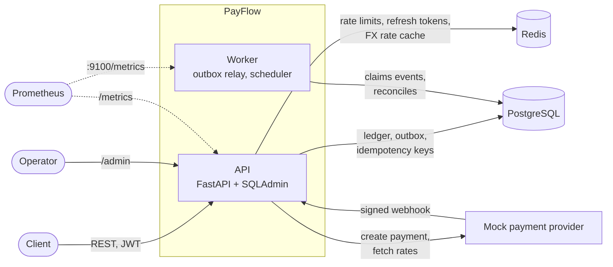
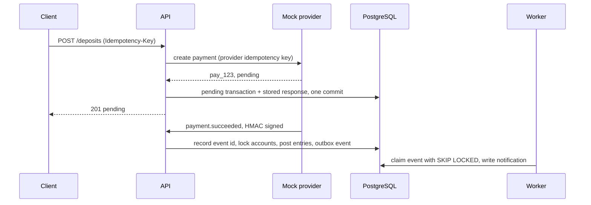

# PayFlow

PayFlow is a backend for a small digital wallet. Users have a KZT and a USD
wallet, top them up through a payment provider, send money to each other by
phone number and exchange between the two currencies. All balance changes are
recorded in a double-entry ledger, every endpoint that moves money is
idempotent, and a test runs 1000 concurrent transfers to check that the total
amount of money does not change.

Stack: Python 3.14, FastAPI, SQLAlchemy 2.0 (async, asyncpg), PostgreSQL 17,
Redis 7, Alembic, Pydantic v2, structlog, Prometheus client, SQLAdmin. Tests use
pytest, testcontainers and Locust; ruff and mypy in strict mode run in CI.

## Features

- Registration and login with JWT access tokens and single-use refresh tokens
  that rotate on every refresh
- A KZT and a USD wallet per user, created at registration
- Deposits through a mock payment provider that confirms payments with signed
  webhooks
- Transfers between users by phone number, with rule-based fraud checks that
  hold suspicious transfers for manual review
- Currency exchange at provider rates cached in Redis, minus a spread
- Transaction history with filters and cursor pagination
- `Idempotency-Key` on every endpoint that moves money
- Per-user rate limit on transfers
- Transactional outbox and a worker that sends user notifications
- Daily reconciliation that recomputes every balance from the ledger
- JSON logs with request ids, Prometheus metrics, health checks
- SQLAdmin panel for browsing the ledger and resolving held transfers

## Architecture



| Service | Role |
| --- | --- |
| `api` | HTTP API, webhook endpoint, admin panel, `/metrics`, `/health` |
| `worker` | Delivers outbox events, runs reconciliation daily and deletes expired idempotency keys hourly |
| `mock-provider` | Stands in for the payment gateway and FX feed; settles payments after a delay and calls back with HMAC-signed webhooks |
| `migrate` | Runs once: applies Alembic migrations and seeds demo data |
| `postgres`, `redis` | Storage |

The code is split into `api` (routes, schemas, and the one place where domain
errors are mapped to HTTP responses), `domain` (services and pure rules: ledger,
fraud scoring, money rounding), `db` (models and repositories), `integrations`
(provider clients), `workers` and `core` (config, logging, security, metrics).
Services called from request handlers never commit; the handler commits before
it returns, so a client never gets a success response for a transaction that
failed to commit.

A deposit from start to finish:



## Design decisions

### Double-entry ledger

Every operation is a row in `transactions` plus `ledger_entries` that sum to
zero per currency. A transfer of 2,500 KZT has two entries. An exchange of 100
USD has four, because each currency has to balance separately:

| Account | Amount |
| --- | ---: |
| Aruzhan, USD wallet | -100.00 USD |
| FX pool, USD | +100.00 USD |
| FX pool, KZT | -50,236.56 KZT |
| Aruzhan, KZT wallet | +50,236.56 KZT |

Deposits, exchanges and held transfers post against system accounts (provider
clearing, FX pool, review hold). System accounts can go negative; user wallets
cannot.

`accounts.balance` is stored so that reads don't have to sum the ledger, but
only `Ledger.post` changes it: for accounts it has locked, in the same database
transaction as the entries it inserts. The database enforces the rules as well:

- a deferred constraint trigger rejects, at commit, a transaction whose entries
  don't sum to zero per currency
- a trigger rejects `UPDATE` and `DELETE` on `ledger_entries`
- a composite foreign key on `(account_id, currency)` prevents posting USD to a
  KZT wallet
- a `CHECK` constraint keeps user balances non-negative

Amounts are `NUMERIC(18,2)` in the database, `Decimal` in Python and strings in
JSON. Exchange rates have 8 decimal places and conversions round down, so an
exchange never creates money.

### Idempotency

Clients retry requests that time out, and without protection a retried
`POST /transfers` would send the money twice. `POST /deposits`, `/transfers` and
`/exchanges` require an `Idempotency-Key` header (400 without one). Keys are
scoped per user.

The key and the response are stored in Postgres in the same transaction as the
money movement, so they commit or roll back together and a stored response
always matches what actually happened. Storing keys in Redis would put them
outside that transaction: a crash between the Redis write and the Postgres
commit would leave the two out of sync.

- A retry gets the original status and body, plus `Idempotent-Replayed: true`.
- A concurrent duplicate waits on the key's primary key until the first request
  finishes and then gets its response, so the money moves once.
- Reusing a key with a different request (method, path and canonical body are
  hashed) returns 422.
- Failed requests are not stored. They had no effects, so a retry runs again.
- Keys are kept for 24 hours.

For deposits the provider also gets an idempotency key, derived from the
client's key. If the API crashes between the provider call and its own commit,
the retry gets the same payment back instead of creating a second one.

### Locking

A posting locks all the accounts it touches in one statement:
`SELECT ... WHERE id = ANY(...) ORDER BY id FOR NO KEY UPDATE`. Two transfers
between the same wallets request the locks in the same order, so one waits for
the other instead of deadlocking.

The first version used `FOR UPDATE`, and the 1000-transfer test deadlocked
within seconds. Inserting the transfer row checks its foreign keys to
`accounts`, so Postgres takes `FOR KEY SHARE` locks on both wallets before the
ordered lock, and `FOR KEY SHARE` conflicts with `FOR UPDATE`. A balance update
doesn't change a key, so `FOR NO KEY UPDATE` is enough, and it doesn't conflict
with foreign key checks. The ledger also refuses to post to an account that
wasn't locked through it, and locked rows are reloaded with `populate_existing`
so a balance read earlier in the session can't be reused.

### Outbox

Notifications are not sent from request handlers. Services write an
`outbox_events` row in the same transaction as the money movement, so an event
exists only if the change committed. The worker claims batches with
`FOR UPDATE SKIP LOCKED`, so several workers can run without picking up the same
event. Each event is handled in its own savepoint, so one failing event doesn't
roll back the rest of the batch. Failures are retried with exponential backoff
and marked `failed` after the attempt limit. Delivery is at least once; a unique
constraint on `(event_id, user_id)` drops duplicate notifications.

### Fraud checks

Each transfer gets a score from three rules:

| Rule | Score |
| --- | ---: |
| amount at or above 1,000,000 KZT or 2,000 USD | 100 |
| first completed transfer to this recipient | 40 |
| 00:00 to 06:00 in Asia/Almaty | 30 |

A score of 60 or more puts the transfer in `pending_review`, so a first transfer
to someone at night is held, but either signal alone is not. The money moves
from the sender to a review hold account immediately, so it can't be spent twice
while the transfer waits. An admin approves it (hold to recipient) or rejects it
(hold back to sender) through the API or the admin panel, and the recipient
doesn't see the transfer until it is approved. Thresholds, scores and the night
window are configurable.

### Rate limiting and exchange rates

Transfers are limited to 10 per rolling minute per user with a sliding window
log in a Lua script. The script reads the time from Redis with `TIME`, so all API
replicas use the same clock, and rejected attempts don't count toward the limit.
Over the limit the API returns 429 with `Retry-After`.

Exchange rates are cached in Redis for a minute and shared by all API processes.
Within one process, concurrent cache misses wait for a single refresh instead of
each calling the provider.

### Reconciliation

Every day at 02:00 UTC the worker recomputes each account balance from its
entries, checks that every transaction and every currency sums to zero, and
stores a report. The checks run in a single `REPEATABLE READ, READ ONLY`
transaction, so transfers that commit during the run don't show up as drift. A
Postgres advisory lock keeps it to one worker at a time. `payflow reconcile`
runs it on demand and exits with status 1 if it finds a problem.

## Running locally

Requires Docker with Compose v2.

```bash
docker compose up --build
```

The `migrate` service applies migrations and seeds demo data before the API and
worker start. No configuration is needed; to change the defaults, copy
`.env.example` to `.env`.

| URL | What |
| --- | --- |
| http://localhost:8000/docs | OpenAPI docs |
| http://localhost:8000/admin | Admin panel |
| http://localhost:8000/metrics | Prometheus metrics (the worker serves its own on port 9100 inside the network) |
| http://localhost:8000/health | Database and Redis checks |
| http://localhost:8001 | Mock payment provider |

Seeded users:

| Phone | Password | Role | KZT | USD |
| --- | --- | --- | ---: | ---: |
| +77000000000 | admin-demo-pass | admin | | |
| +77010000001 | demo-pass-123 | Aruzhan | 1,287,000.00 | 1,200.00 |
| +77010000002 | demo-pass-123 | Daniyar | 330,500.00 | 300.00 |
| +77010000003 | demo-pass-123 | Madina | 97,500.00 | 0.00 |

The seed also creates a 1,200,000 KZT transfer from Aruzhan to Madina that is
waiting for review, so there is something to approve in the admin panel.

Other commands (also available as `make` targets):

```bash
make logs                               # follow api, worker and provider logs
docker compose exec worker payflow reconcile
docker compose --profile loadtest up locust    # Locust UI on :8089
docker compose down --volumes           # stop and delete the data
```

## API examples

The examples use `jq` and `uuidgen`, and the responses are trimmed. Log in as a
seeded customer:

```bash
TOKEN=$(curl -s localhost:8000/api/v1/auth/login \
  -H 'Content-Type: application/json' \
  -d '{"phone": "+77010000001", "password": "demo-pass-123"}' | jq -r .access_token)
AUTH="Authorization: Bearer $TOKEN"

curl -s localhost:8000/api/v1/accounts -H "$AUTH" | jq
```

Deposit 5,000 KZT. The deposit starts as `pending`; about two seconds later the
mock provider calls the webhook and the wallet is credited:

```bash
curl -s localhost:8000/api/v1/deposits -H "$AUTH" -H 'Content-Type: application/json' \
  -H "Idempotency-Key: $(uuidgen)" \
  -d '{"currency": "KZT", "amount": "5000.00"}' | jq
```

```json
{
  "id": "01a14065-e820-73b1-bd19-9ec2d2a69c36",
  "type": "deposit",
  "status": "pending",
  "direction": "incoming",
  "amount": "5000.00",
  "currency": "KZT",
  "provider_payment_id": "pay_5b2d51c0f0c7fe44eb081c89",
  "created_at": "2026-10-15T16:29:42.809683Z",
  "completed_at": null
}
```

Transfer by phone number. Local formats such as `8 701 ...` are converted to
E.164:

```bash
curl -s localhost:8000/api/v1/transfers -H "$AUTH" -H 'Content-Type: application/json' \
  -H 'Idempotency-Key: lunch-0001' \
  -d '{"to_phone": "8 701 000 00 02", "amount": "2500.00", "currency": "KZT", "comment": "lunch"}' | jq
```

```json
{
  "id": "01a14065-e884-7275-a122-00709a65c063",
  "type": "transfer",
  "status": "completed",
  "direction": "outgoing",
  "amount": "2500.00",
  "currency": "KZT",
  "counterparty_phone": "+77010000002",
  "comment": "lunch",
  "created_at": "2026-10-15T16:29:42.902002Z",
  "completed_at": "2026-10-15T16:29:42.912482Z"
}
```

Repeating the request returns the same body with `Idempotent-Replayed: true`
and doesn't create a second transfer. All errors have the same format:

```json
{"error": {"code": "insufficient_funds", "message": "insufficient funds"}}
```

Exchange 100 USD to KZT at the cached rate minus the 0.5% spread:

```bash
curl -s localhost:8000/api/v1/exchange/rates | jq
curl -s localhost:8000/api/v1/exchanges -H "$AUTH" -H 'Content-Type: application/json' \
  -H "Idempotency-Key: $(uuidgen)" \
  -d '{"from_currency": "USD", "to_currency": "KZT", "amount": "100.00"}' | jq
```

```json
{
  "type": "exchange",
  "status": "completed",
  "direction": "internal",
  "amount": "100.00",
  "currency": "USD",
  "counter_amount": "50236.56",
  "counter_currency": "KZT",
  "exchange_rate": "502.36564950"
}
```

History is sorted newest first and can be filtered by `type`, `status`,
`currency`, `direction`, `created_from`, `created_to`, `min_amount` and
`max_amount`. To get the next page, pass `next_cursor` as `cursor`.
Notifications from the worker have their own endpoint:

```bash
curl -s "localhost:8000/api/v1/transactions?type=transfer&limit=2" -H "$AUTH" | jq
curl -s "localhost:8000/api/v1/notifications?limit=3" -H "$AUTH" | jq '.[].message'
```

```text
"You exchanged 100.00 USD for 50,236.56 KZT"
"5,000.00 KZT was added to your wallet"
"You sent 2,500.00 KZT to +7701***0002"
```

Approve the held transfer as the admin:

```bash
ADMIN_TOKEN=$(curl -s localhost:8000/api/v1/auth/login \
  -H 'Content-Type: application/json' \
  -d '{"phone": "+77000000000", "password": "admin-demo-pass"}' | jq -r .access_token)
REVIEW_ID=$(curl -s localhost:8000/api/v1/admin/reviews \
  -H "Authorization: Bearer $ADMIN_TOKEN" | jq -r '.[0].id')
curl -s -X POST "localhost:8000/api/v1/admin/reviews/$REVIEW_ID/approve" \
  -H "Authorization: Bearer $ADMIN_TOKEN" | jq -r .status
```

## Tests

```bash
uv sync
make check        # ruff, mypy --strict, pytest
make cov          # with coverage
```

Integration tests start Postgres and Redis with testcontainers, so Docker is the
only requirement. In CI they use service containers instead, configured through
`TEST_DATABASE_URL` and `TEST_REDIS_URL`.

There are 187 tests (70 unit, 117 integration). They take about 40 seconds and
cover 97% of the code with branch coverage enabled; CI fails below 80%. ruff and
mypy in strict mode check `src`, `tests` and the migrations.

Besides the normal API flows, the integration tests cover:

- 1000 concurrent transfers between 20 wallets that start with 10,000 KZT each,
  for random amounts between 0.01 and 1,000 KZT, each on its own connection.
  Afterwards the wallet total is unchanged, no wallet is negative, every stored
  balance equals the sum of its entries, all entries sum to zero, every transfer
  either completed or failed with insufficient funds, and there were no
  deadlocks. The test takes about 12 seconds on a Windows laptop with Docker
  Desktop.
- Five parallel requests with the same idempotency key, which produce one
  transfer and four replays.
- Database rules: unbalanced entries fail at commit, ledger rows can't be
  updated or deleted, entries in the wrong currency are rejected, and the
  migrations match the models.
- Webhooks: forged, unsigned and expired signatures are rejected; redelivered
  and late events are applied once; an event that arrives before its deposit is
  committed gets a 404 and succeeds when the provider retries.
- A full deposit, and a declined one, with PayFlow and the mock provider running
  in the same process and calling each other.
- The outbox: retries with backoff, dead-lettering, a failing event not
  affecting the rest of its batch, and three relays working the same queue
  without delivering an event twice.
- Reconciliation finding an edited balance and unbalanced entries written with
  the trigger disabled, and skipping when another worker holds the lock.

### Load test

Locust against the compose stack on Windows 11 with Docker Desktop (8 vCPUs,
4 GB RAM, one uvicorn process). Each simulated user registers and deposits, then
checks balances, reads history and rates, and sends transfers and exchanges,
waiting 0.5 to 2 seconds between requests. 409 (insufficient funds) and 429
(rate limited) responses count as expected.

| Users | Requests | Errors | Throughput | Median | p95 | p99 |
| ---: | ---: | ---: | ---: | ---: | ---: | ---: |
| 50 | 2,442 | 0 | 41 req/s | 11 ms | 120 ms | 160 ms |
| 200 | 7,951 | 0 | 133 req/s | 120 ms | 910 ms | 2,000 ms |

At 50 users the median transfer took 28 ms and p95 was 63 ms. Logins take about
120 ms because Argon2 hashing is deliberately slow. At 200 users the single API
process is the bottleneck. After both runs reconciliation found no drift in 513
accounts, the 6,238 ledger entries summed to exactly zero per currency, and all
2,403 outbox events had been delivered.

## Project layout

```text
src/payflow/
  api/            routes, schemas, dependencies, error mapping, middleware,
                  idempotency, SQLAdmin views
  core/           settings, logging, security, rate limiter, metrics, clock
  db/             models, session factory, repositories
  domain/         enums, exceptions, ledger, fraud rules, money, phone numbers,
                  ports, services/
  integrations/   payment provider client and webhook verification, FX rates
  workers/        outbox relay, scheduler, jobs, runner
  cli.py          payflow worker | reconcile | seed
  seed.py         demo data
  main.py         app factory
src/mock_provider/  fake payment gateway and FX feed
alembic/            migrations, including the ledger triggers
tests/unit/         pure logic, no I/O
tests/integration/  API, database, Redis and worker tests
loadtest/           Locust scenario
```

## Configuration

Settings are read from environment variables and `.env` with pydantic-settings.
The ones most likely to need changing:

| Variable | Default | Meaning |
| --- | --- | --- |
| `DATABASE_URL`, `REDIS_URL` | | Connection strings |
| `JWT_SECRET`, `ADMIN_SESSION_SECRET` | | Signing keys |
| `PAYMENT_PROVIDER_URL`, `PAYMENT_PROVIDER_API_KEY`, `PAYMENT_PROVIDER_WEBHOOK_SECRET` | | Provider access and webhook HMAC secret |
| `FX_PROVIDER_URL` | | Rate feed |
| `ACCESS_TOKEN_TTL_SECONDS`, `REFRESH_TOKEN_TTL_SECONDS` | 900, 604800 | Token lifetimes |
| `TRANSFER_RATE_LIMIT`, `TRANSFER_RATE_WINDOW_SECONDS` | 10, 60 | Transfers per user per window |
| `FX_RATES_TTL_SECONDS`, `FX_SPREAD` | 60, 0.005 | Rate cache lifetime and spread |
| `FRAUD__LARGE_AMOUNT_KZT`, `FRAUD__LARGE_AMOUNT_USD` | 1000000, 2000 | Large amount thresholds |
| `FRAUD__NIGHT_STARTS_AT`, `FRAUD__NIGHT_ENDS_AT`, `FRAUD__TIMEZONE` | 00:00, 06:00, Asia/Almaty | Night window |
| `FRAUD__REVIEW_THRESHOLD` | 60 | Score that sends a transfer to review |
| `OUTBOX_POLL_INTERVAL_SECONDS`, `OUTBOX_MAX_ATTEMPTS` | 1.0, 8 | Relay polling and retry limit |
| `RECONCILIATION_RUN_AT` | 02:00 | Daily run time, UTC |
| `IDEMPOTENCY_KEY_TTL_HOURS` | 24 | How long keys are kept |

The full list is in `src/payflow/core/config.py`.

## Limitations

- System accounts are hot rows: every deposit locks the provider clearing
  account. That's fine at this scale; with more traffic they could be split into
  several sub-accounts, or keep no stored balance since they can go negative
  anyway.
- Access tokens are stateless. A deactivated user is rejected on their next
  request because the user is loaded on each request, but a leaked access token
  stays valid for up to 15 minutes. Refresh tokens can be revoked.
- Exchanges use the cached rate at the time of the request. A real product would
  give the user a quote with an expiry time so they agree to the exact rate.
- Reconciliation reads the whole ledger. A large ledger would need incremental
  checks from a saved checkpoint.
- The API and worker each run as one process in compose. Both can run as several
  instances: the relay uses `SKIP LOCKED`, the scheduled job takes an advisory
  lock, and rate limits and caches are in Redis.
- Not implemented: withdrawals, KYC, per-user limits, currencies other than KZT
  and USD.
- The mock provider keeps payments in memory, so restarting it loses unsettled
  payments.
