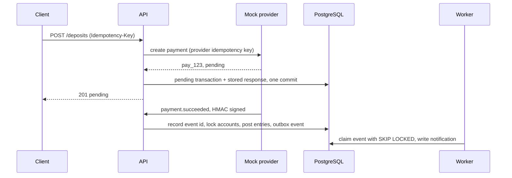

# PayFlow

PayFlow is the backend of a small digital wallet. Users hold a KZT and a USD
wallet, top them up through a payment provider, send money to each other by
phone number and exchange between currencies. Every movement of money is a
balanced set of entries in a double-entry ledger, every write endpoint is
idempotent, and the money stays consistent under concurrency: a test runs 1000
parallel transfers and checks that not a single tiyn appears or disappears.

Built with Python 3.14, FastAPI, SQLAlchemy 2.0 (async, asyncpg), PostgreSQL 17,
Redis 7, Alembic, Pydantic v2, structlog, Prometheus and SQLAdmin. Tested with
pytest, testcontainers and Locust, checked with ruff and mypy in strict mode.

## Contents

- [Features](#features)
- [Architecture](#architecture)
- [Design decisions](#design-decisions)
- [Running it](#running-it)
- [API walkthrough](#api-walkthrough)
- [Tests and results](#tests-and-results)
- [Project layout](#project-layout)
- [Configuration](#configuration)
- [Trade-offs and next steps](#trade-offs-and-next-steps)

## Features

- Registration and login with JWT access tokens and rotating, single-use
  refresh tokens
- A KZT and a USD wallet per user, opened at registration
- Deposits through a mock payment provider that confirms payments with signed
  webhooks
- Transfers between users by phone number, with a rule-based fraud check that
  parks risky transfers for manual review
- Currency exchange at provider rates cached in Redis, minus a spread
- Transaction history with filters and cursor pagination
- `Idempotency-Key` on every endpoint that moves money
- Per-user rate limiting of transfers
- A transactional outbox and a worker that delivers user notifications
- A daily reconciliation job that recomputes every balance from the ledger
- JSON logs with request ids, Prometheus metrics, health checks
- An SQLAdmin panel for browsing the ledger and resolving held transfers

## Architecture


| Service | Role |
| --- | --- |
| `api` | HTTP API, webhook endpoint, admin panel, `/metrics`, `/health` |
| `worker` | Delivers outbox events, runs reconciliation daily and purges expired idempotency keys hourly |
| `mock-provider` | Stands in for the payment gateway and FX feed; settles payments after a delay and calls back with HMAC-signed webhooks |
| `migrate` | One-shot: applies Alembic migrations and seeds demo data |
| `postgres`, `redis` | Storage |

The code is layered: `api` (routes, schemas, the single place where domain
errors become HTTP responses), `domain` (services and pure rules such as the
ledger, fraud scoring and money rounding), `db` (models and repositories),
`integrations` (provider clients), `workers` and `core` (config, logging,
security, metrics). Services that run inside a request never commit; the route
does, after the work is done, so a client never gets a success response for a
transaction that failed to commit.

A deposit end to end:



## Design decisions

### Money lives in a ledger, balances are a projection of it

Every operation is a `transactions` row plus `ledger_entries` that sum to zero
in each currency. A transfer of 2,500 KZT is two entries; an exchange of 100 USD
is four, because each currency has to balance on its own:

| Account | Amount |
| --- | ---: |
| Aruzhan, USD wallet | -100.00 USD |
| FX pool, USD | +100.00 USD |
| FX pool, KZT | -50,236.56 KZT |
| Aruzhan, KZT wallet | +50,236.56 KZT |

System accounts (provider clearing, FX pool, review hold) are the other side of
money entering, converting or waiting, and they are allowed to go negative.
User wallets are not.

`accounts.balance` is kept so reads stay cheap, but nothing edits it directly.
`Ledger.post` is the only writer: it changes balances of accounts it has locked,
in the same database transaction as the entries it inserts. The database backs
this up independently of the application code:

- a deferred constraint trigger rejects, at commit, any transaction whose
  entries do not sum to zero per currency
- a trigger rejects `UPDATE` and `DELETE` on `ledger_entries`
- a composite foreign key `(account_id, currency)` makes it impossible to post
  USD to a KZT wallet
- a `CHECK` constraint keeps user balances non-negative

Amounts are `NUMERIC(18,2)` and `Decimal` end to end and travel as strings in
JSON. Exchange rates are kept to 8 decimal places and conversions round down, so
an exchange can never create money.

### Every write that moves money is idempotent

Mobile clients retry. Without protection, a timeout on `POST /transfers` followed
by a retry sends the money twice. `POST /deposits`, `/transfers` and
`/exchanges` require an `Idempotency-Key` header (400 without one), scoped to the
user.

The key is stored in Postgres, in the same transaction as the money movement,
together with the response. The two commit or roll back together, so a stored
response always describes effects that really happened. Keeping keys in Redis
was the alternative, but a crash between the Redis write and the Postgres commit
leaves the two disagreeing, which is the exact failure the key exists to prevent.

- A retry gets the original status and body back, with `Idempotent-Replayed: true`.
- A concurrent duplicate blocks on the key's primary key until the first request
  finishes, then replays its response. The money moves once.
- Reusing a key with a different body (method, path and canonical payload are
  hashed) returns 422.
- Failed requests are not stored: they had no effects, so a retry runs again.
- Keys expire after 24 hours.

Deposits extend this to the provider: the provider receives a key derived from
the client's key, so a retry after a crash between the provider call and our
commit resolves to the same payment instead of charging twice.

### Locks are taken in one order, with the weakest mode that works

A posting locks every account it touches with one statement:
`SELECT ... WHERE id = ANY(...) ORDER BY id FOR NO KEY UPDATE`. Two transfers
over the same wallets always ask for the locks in the same order, so they queue
instead of deadlocking.

The first version used plain `FOR UPDATE`, and the 1000-transfer test
deadlocked within seconds. Inserting the transfer row checks its foreign keys to
`accounts`, which makes Postgres take `FOR KEY SHARE` locks on both wallets
before the ordered lock runs, and `FOR KEY SHARE` conflicts with `FOR UPDATE`.
Changing a balance is not a key update, so `FOR NO KEY UPDATE` is the right
mode, and it does not conflict with foreign key checks. The ledger refuses to
post to an account that was not locked through it, and locked rows are reloaded
with `populate_existing` so a stale balance from earlier in the session cannot
be used.

### Side effects go through an outbox

Notifications are not sent from request handlers. Services write an
`outbox_events` row in the same transaction as the money movement, so an event
exists if and only if the change committed. The worker claims batches with
`FOR UPDATE SKIP LOCKED`, so several workers can run without delivering an event
twice. Each event is handled in its own savepoint, so one bad event does not
hold back the batch. Failures retry with exponential backoff and, after the
attempt limit, are marked `failed` for an operator to look at. Delivery is at
least once; a unique `(event_id, user_id)` constraint absorbs duplicates.

### Risky transfers wait on a hold account

Each transfer gets a fraud score from three rules:

| Signal | Score |
| --- | ---: |
| amount at or above 1,000,000 KZT or 2,000 USD | 100 |
| first completed transfer to this recipient | 40 |
| 00:00 to 06:00 in Asia/Almaty | 30 |

At 60 or more the transfer is `pending_review`. A first transfer to someone at
night is held; either signal alone is not. The money moves from the sender to a
review-hold system account straight away, so it cannot be spent twice while
waiting. An admin approves (hold to recipient) or rejects (hold back to sender)
through the API or the admin panel, and the recipient sees nothing until
approval. Thresholds, weights and the night window are configuration.

### Rate limits and rate caches live in Redis

Transfers are limited to 10 per rolling minute per user, using a sliding-window
log in a Lua script. The script reads the time with `TIME`, so every API replica
agrees on the window, and rejected attempts do not count against it. Over the
limit the API returns 429 with `Retry-After`.

Exchange rates are cached in Redis for a minute and shared by every API
process. Within a process, concurrent cache misses wait for a single refresh
instead of all calling the provider.

### Reconciliation reads one snapshot

Every day at 02:00 UTC the worker recomputes each account balance from its
entries, checks that every transaction and every currency sums to zero, and
stores a report. All checks run in one `REPEATABLE READ, READ ONLY` transaction,
so transfers that commit while it runs cannot look like drift. A Postgres
advisory lock lets only one worker run it. `payflow reconcile` runs it on demand
and exits with status 1 when it finds a problem.

## Running it

Requires Docker with Compose v2.

```bash
docker compose up --build
```

Migrations and demo data are applied by the `migrate` service before the API and
worker start. Nothing needs configuring; every variable in `.env.example` has a
local default and can be overridden by copying it to `.env`.

| URL | What |
| --- | --- |
| http://localhost:8000/docs | OpenAPI docs |
| http://localhost:8000/admin | Admin panel |
| http://localhost:8000/metrics | Prometheus metrics (worker: port 9100 inside the network) |
| http://localhost:8000/health | Database and Redis checks |
| http://localhost:8001 | Mock payment provider |

Demo users, all with the KZT/USD balances below after seeding:

| Phone | Password | Role | KZT | USD |
| --- | --- | --- | ---: | ---: |
| +77000000000 | admin-demo-pass | admin | | |
| +77010000001 | demo-pass-123 | Aruzhan | 1,287,000.00 | 1,200.00 |
| +77010000002 | demo-pass-123 | Daniyar | 330,500.00 | 300.00 |
| +77010000003 | demo-pass-123 | Madina | 97,500.00 | 0.00 |

The seed also leaves one 1,200,000 KZT transfer from Aruzhan to Madina waiting
for review, so the admin panel has something to approve.

Useful commands (`make` targets wrap them):

```bash
make logs                               # follow api, worker and provider logs
docker compose exec worker payflow reconcile
docker compose --profile loadtest up locust    # Locust UI on :8089
docker compose down --volumes           # stop and wipe data
```

## API walkthrough

The examples use `jq` and `uuidgen`; responses are trimmed to the interesting
fields. Log in as a seeded customer:

```bash
TOKEN=$(curl -s localhost:8000/api/v1/auth/login \
  -H 'Content-Type: application/json' \
  -d '{"phone": "+77010000001", "password": "demo-pass-123"}' | jq -r .access_token)
AUTH="Authorization: Bearer $TOKEN"

curl -s localhost:8000/api/v1/accounts -H "$AUTH" | jq
```

Top up 5,000 KZT. The deposit starts as `pending`; about two seconds later the
mock provider calls the webhook and the wallet is credited:

```bash
curl -s localhost:8000/api/v1/deposits -H "$AUTH" -H 'Content-Type: application/json' \
  -H "Idempotency-Key: $(uuidgen)" \
  -d '{"currency": "KZT", "amount": "5000.00"}' | jq
```

```json
{
  "id": "01a14065-e820-73b1-bd19-9ec2d2a69c36",
  "type": "deposit",
  "status": "pending",
  "direction": "incoming",
  "amount": "5000.00",
  "currency": "KZT",
  "provider_payment_id": "pay_5b2d51c0f0c7fe44eb081c89",
  "created_at": "2026-10-15T16:29:42.809683Z",
  "completed_at": null
}
```

Send money by phone number. Local formats such as `8 701 ...` are normalized
to E.164:

```bash
curl -s localhost:8000/api/v1/transfers -H "$AUTH" -H 'Content-Type: application/json' \
  -H 'Idempotency-Key: lunch-0001' \
  -d '{"to_phone": "8 701 000 00 02", "amount": "2500.00", "currency": "KZT", "comment": "lunch"}' | jq
```

```json
{
  "id": "01a14065-e884-7275-a122-00709a65c063",
  "type": "transfer",
  "status": "completed",
  "direction": "outgoing",
  "amount": "2500.00",
  "currency": "KZT",
  "counterparty_phone": "+77010000002",
  "comment": "lunch",
  "created_at": "2026-10-15T16:29:42.902002Z",
  "completed_at": "2026-10-15T16:29:42.912482Z"
}
```

Sending the same request again returns the same body with
`Idempotent-Replayed: true`, and no second transfer happens. Errors share one
shape:

```json
{"error": {"code": "insufficient_funds", "message": "insufficient funds"}}
```

Exchange 100 USD into KZT at the cached rate minus the 0.5% spread:

```bash
curl -s localhost:8000/api/v1/exchange/rates | jq
curl -s localhost:8000/api/v1/exchanges -H "$AUTH" -H 'Content-Type: application/json' \
  -H "Idempotency-Key: $(uuidgen)" \
  -d '{"from_currency": "USD", "to_currency": "KZT", "amount": "100.00"}' | jq
```

```json
{
  "type": "exchange",
  "status": "completed",
  "direction": "internal",
  "amount": "100.00",
  "currency": "USD",
  "counter_amount": "50236.56",
  "counter_currency": "KZT",
  "exchange_rate": "502.36564950"
}
```

History is newest first, filterable by `type`, `status`, `currency`,
`direction`, `created_from`, `created_to`, `min_amount` and `max_amount`; pass
`next_cursor` back as `cursor` for the next page. Notifications written by the
worker are listed separately:

```bash
curl -s "localhost:8000/api/v1/transactions?type=transfer&limit=2" -H "$AUTH" | jq
curl -s "localhost:8000/api/v1/notifications?limit=3" -H "$AUTH" | jq '.[].message'
```

```text
"You exchanged 100.00 USD for 50,236.56 KZT"
"5,000.00 KZT was added to your wallet"
"You sent 2,500.00 KZT to +7701***0002"
```

Resolve the held transfer as the admin:

```bash
ADMIN_TOKEN=$(curl -s localhost:8000/api/v1/auth/login \
  -H 'Content-Type: application/json' \
  -d '{"phone": "+77000000000", "password": "admin-demo-pass"}' | jq -r .access_token)
REVIEW_ID=$(curl -s localhost:8000/api/v1/admin/reviews \
  -H "Authorization: Bearer $ADMIN_TOKEN" | jq -r '.[0].id')
curl -s -X POST "localhost:8000/api/v1/admin/reviews/$REVIEW_ID/approve" \
  -H "Authorization: Bearer $ADMIN_TOKEN" | jq -r .status
```

## Tests and results

```bash
uv sync
make check        # ruff, mypy --strict, pytest
make cov          # with coverage
```

Integration tests start Postgres and Redis with testcontainers, so Docker is the
only requirement. CI points them at service containers instead through
`TEST_DATABASE_URL` and `TEST_REDIS_URL`.

| | |
| --- | --- |
| Tests | 187 (70 unit, 117 integration), about 40 s |
| Coverage | 97% with branch coverage, CI fails below 80% |
| Static checks | ruff, mypy `--strict` over `src`, `tests` and migrations |

What the integration tests cover beyond the happy paths:

- **1000 parallel transfers.** 20 wallets with 10,000 KZT each and 1000 random
  transfers of 0.01 to 1,000 KZT, all started at once on separate connections.
  Afterwards the total across wallets is unchanged, no wallet is negative, every
  stored balance equals the sum of its entries, all entries sum to zero, and
  every transfer either completed or failed cleanly with insufficient funds. No
  deadlocks. It takes about 12 s on a Windows laptop through Docker Desktop.
- **Concurrent retries.** Five identical requests with one idempotency key, sent
  in parallel, produce one transfer and four replays.
- **Database guarantees.** Unbalanced entries fail at commit, ledger rows cannot
  be updated or deleted, cross-currency entries are refused, and migrations
  match the models.
- **Webhooks.** Forged, unsigned and stale signatures are rejected; redelivered
  and late events are applied once; an event that arrives before its deposit is
  committed gets a 404 and succeeds when the provider retries.
- **The real provider.** PayFlow and the mock provider run in the same process,
  each calling the other, for a full deposit and a declined one.
- **Outbox.** Retries with backoff, dead-lettering, isolation of a failing event,
  and three relays draining the same queue without delivering anything twice.
- **Reconciliation.** Detects an edited balance and unbalanced entries written
  with the trigger disabled; skips when another worker holds the lock.

Load test with Locust against the compose stack (Windows 11, Docker Desktop VM
with 8 vCPUs and 4 GB RAM, one uvicorn process). Each simulated user registers,
deposits, then checks balances, reads history and rates, sends transfers and
exchanges with think time between requests. Insufficient funds and rate limiting
count as expected answers.

| Users | Requests | Errors | Throughput | Median | p95 | p99 |
| ---: | ---: | ---: | ---: | ---: | ---: | ---: |
| 50 | 2,442 | 0 | 41 req/s | 11 ms | 120 ms | 160 ms |
| 200 | 7,951 | 0 | 133 req/s | 120 ms | 910 ms | 2,000 ms |

At 50 users transfers took 28 ms at the median and 63 ms at p95; logins sit
around 120 ms because Argon2 is meant to be slow. At 200 users the single API
process is saturated. After both runs reconciliation found no drift across 513
accounts, the 6,238 ledger entries summed to exactly zero in each currency, and
all 2,403 outbox events had been delivered.

## Project layout

```text
src/payflow/
  api/            routes, schemas, dependencies, error mapping, middleware,
                  idempotency, SQLAdmin views
  core/           settings, logging, security, rate limiter, metrics, clock
  db/             models, session factory, repositories
  domain/         enums, exceptions, ledger, fraud rules, money, phone numbers,
                  ports, services/
  integrations/   payment provider client and webhook verification, FX rates
  workers/        outbox relay, scheduler, jobs, runner
  cli.py          payflow worker | reconcile | seed
  seed.py         demo data
  main.py         app factory
src/mock_provider/  fake payment gateway and FX feed
alembic/            migrations, including the ledger triggers
tests/unit/         pure logic, no I/O
tests/integration/  API, database, Redis and worker tests
loadtest/           Locust scenario
```

## Configuration

Settings are read from the environment (and `.env`) by pydantic-settings. The
ones you are most likely to change:

| Variable | Default | Meaning |
| --- | --- | --- |
| `DATABASE_URL`, `REDIS_URL` | | Connection strings |
| `JWT_SECRET`, `ADMIN_SESSION_SECRET` | | Signing keys |
| `PAYMENT_PROVIDER_URL`, `PAYMENT_PROVIDER_API_KEY`, `PAYMENT_PROVIDER_WEBHOOK_SECRET` | | Provider access and webhook HMAC secret |
| `FX_PROVIDER_URL` | | Rate feed |
| `ACCESS_TOKEN_TTL_SECONDS`, `REFRESH_TOKEN_TTL_SECONDS` | 900, 604800 | Token lifetimes |
| `TRANSFER_RATE_LIMIT`, `TRANSFER_RATE_WINDOW_SECONDS` | 10, 60 | Transfers per user per window |
| `FX_RATES_TTL_SECONDS`, `FX_SPREAD` | 60, 0.005 | Rate cache lifetime and spread |
| `FRAUD__LARGE_AMOUNT_KZT`, `FRAUD__LARGE_AMOUNT_USD` | 1000000, 2000 | Large amount thresholds |
| `FRAUD__NIGHT_STARTS_AT`, `FRAUD__NIGHT_ENDS_AT`, `FRAUD__TIMEZONE` | 00:00, 06:00, Asia/Almaty | Night window |
| `FRAUD__REVIEW_THRESHOLD` | 60 | Score that sends a transfer to review |
| `OUTBOX_POLL_INTERVAL_SECONDS`, `OUTBOX_MAX_ATTEMPTS` | 1.0, 8 | Relay polling and retry limit |
| `RECONCILIATION_RUN_AT` | 02:00 | Daily run time, UTC |
| `IDEMPOTENCY_KEY_TTL_HOURS` | 24 | How long keys are kept |

The full list is in `src/payflow/core/config.py`.

## Trade-offs and next steps

- System accounts are hot rows: every deposit locks the provider clearing
  account. That is fine at this scale; at higher volume they would be split into
  several sub-accounts, or stop keeping a stored balance since they are allowed
  to go negative anyway.
- Access tokens are stateless. A deactivated user is rejected on the next
  request because the user is loaded per request, but a leaked access token
  stays valid for up to 15 minutes. Refresh tokens can be revoked.
- Exchanges run at the cached rate at the time of the request. A real product
  would issue a quote with an expiry so the user agrees to the exact rate.
- Reconciliation scans the whole ledger. A large ledger would need incremental
  checks from a stored checkpoint.
- The API and worker run as single processes in compose. Both can scale out:
  the relay uses `SKIP LOCKED`, the scheduled job takes an advisory lock, and
  limits and caches live in Redis.
- Out of scope: withdrawals, KYC, per-user limits, currencies beyond KZT and USD.
- The mock provider keeps payments in memory; restarting it loses unsettled ones.
